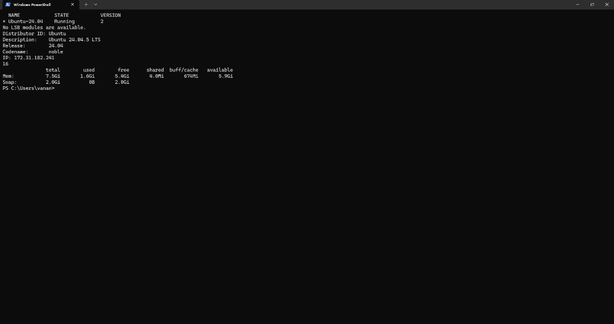
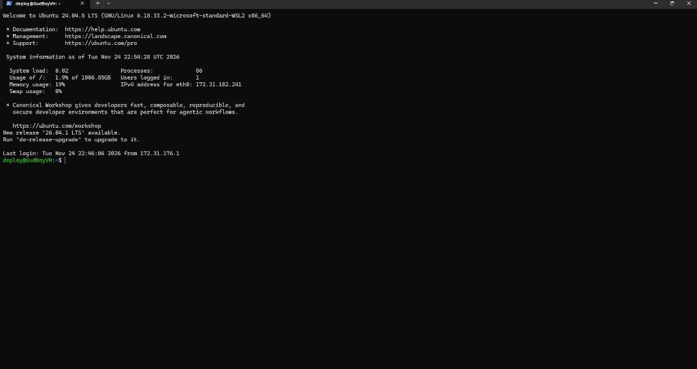
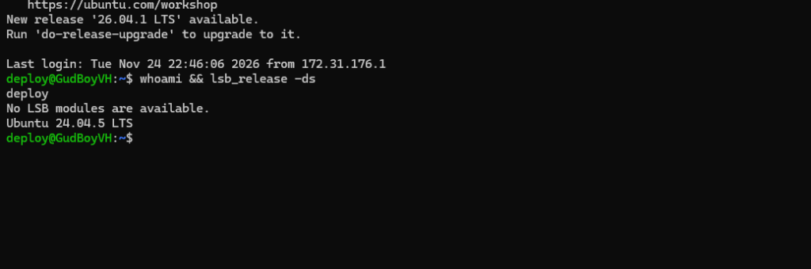

# Bài tập 1: Khởi tạo và kết nối VPS

## 1. Cấu hình VM Ubuntu (Local VM — Ubuntu 24.04.5 LTS)
- **Hệ điều hành:** Ubuntu 24.04.5 LTS
- **Tài nguyên:** 16 vCPU, 7.5 GiB RAM
- **Địa chỉ IP VM:** `172.31.182.241`

## 2. Kết nối SSH từ Windows PowerShell
Xem chi tiết câu lệnh trong [`commands.txt`](./commands.txt).

## 3. Ảnh minh chứng kết quả
### Thông số VM Ubuntu

### Đăng nhập SSH thành công từ PowerShell

### Xác nhận tài khoản & phiên bản hệ điều hành

